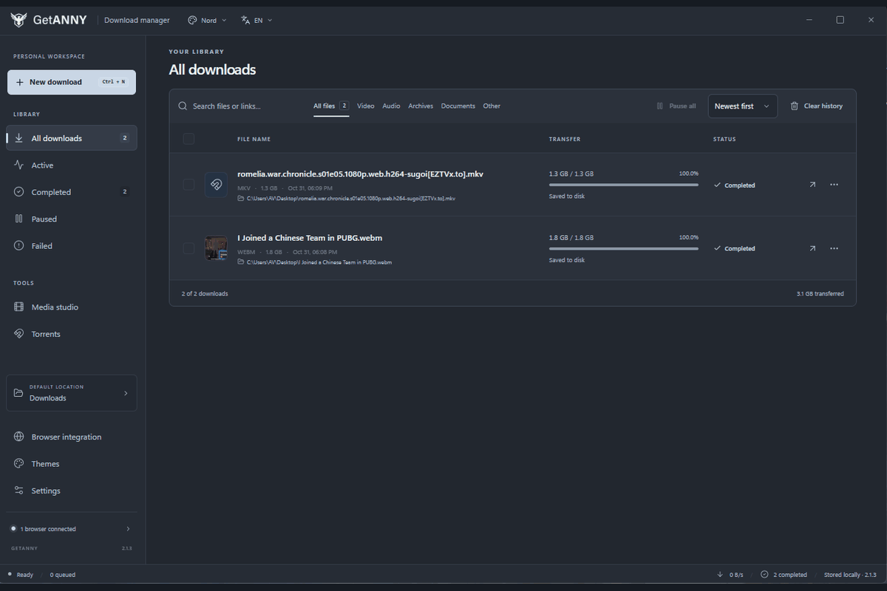
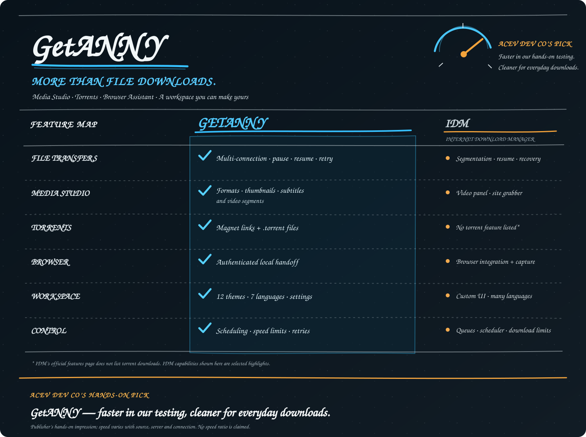
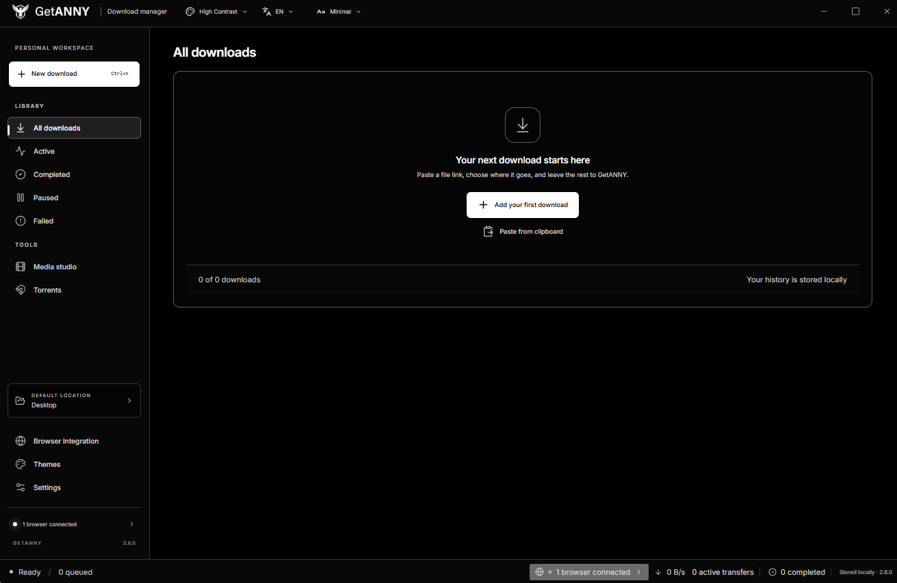
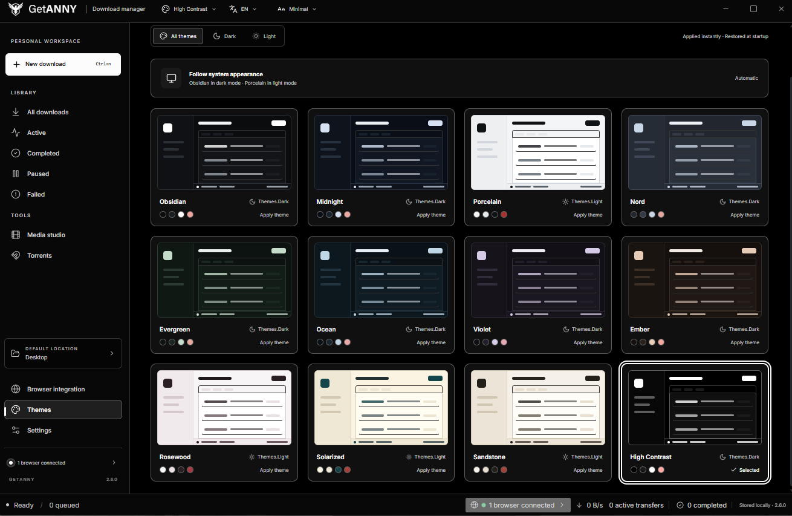
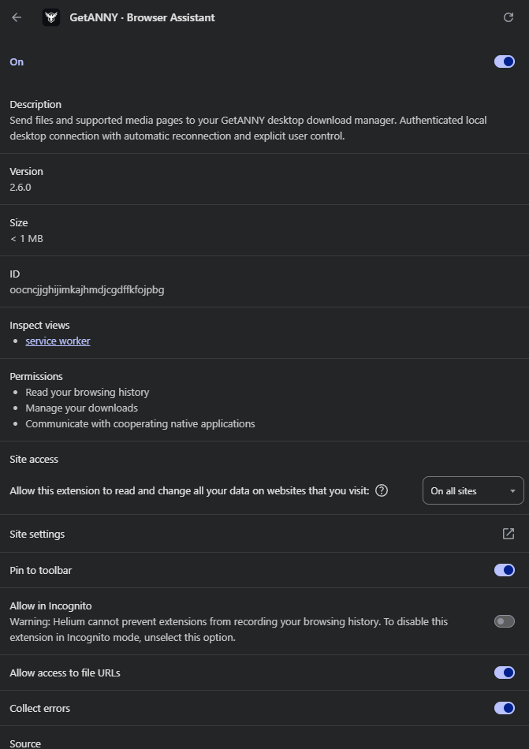
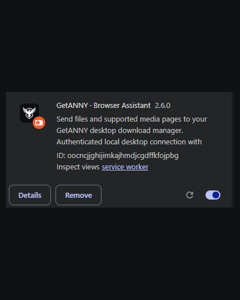

<p align="center">
  <picture>
    <source media="(prefers-color-scheme: dark)" srcset="assets/brand/lockup-horizontal-white.png">
    
  </picture>
</p>

<h1 align="center">GetANNY Download Manager</h1>

<p align="center"><strong>A focused Windows download manager for files, media and browser downloads.</strong></p>

<p align="center">
  <a href="https://github.com/p4yy/GetANNY/releases/latest">Download for Windows</a>
  &nbsp;·&nbsp;
  <a href="https://youtu.be/lzJW8I6n3Yw">Installation video</a>
  &nbsp;·&nbsp;
  <a href="https://youtu.be/jrJ0kYSQAlk">Product walkthrough</a>
  &nbsp;·&nbsp;
  <a href="docs/INSTALL_WINDOWS.md">Windows install guide</a>
</p>

<table align="center">
  <tr>
    <td align="center" width="50%"><strong>File downloads</strong><br><sub>Multi-connection transfers, pause, resume and retry</sub></td>
    <td align="center" width="50%"><strong>Media Studio</strong><br><sub>Formats, thumbnails, subtitles and video segments</sub></td>
  </tr>
  <tr>
    <td align="center" width="50%"><strong>Browser integration</strong><br><sub>Send supported links over an authenticated local connection</sub></td>
    <td align="center" width="50%"><strong>Torrent support</strong><br><sub>Add magnet links and .torrent files</sub></td>
  </tr>
</table>

<p align="center">
  
</p>

<p align="center"><sub>Preview of the Windows app · Full walkthroughs below</sub></p>

<p align="center">
  <a href="https://github.com/p4yy/GetANNY/actions/workflows/release.yml"></a>
  <a href="https://github.com/p4yy/GetANNY/releases/latest"></a>
  <a href="https://github.com/p4yy/GetANNY/releases"></a>
  
</p>
<p align="center">
  <a href="https://github.com/p4yy/GetANNY/blob/main/LICENSE"></a>
  <a href="https://github.com/p4yy/GetANNY/stargazers"></a>
  <a href="https://github.com/p4yy/GetANNY/forks"></a>
  <a href="https://github.com/p4yy/GetANNY/issues"></a>
</p>
<p align="center">
  <a href="https://github.com/p4yy/GetANNY/commits/main"></a>
  <a href="https://github.com/p4yy/GetANNY"></a>
  <a href="https://github.com/p4yy/GetANNY/graphs/contributors"></a>
</p>

<p align="center">
  <a href="#download">Download</a>
  &nbsp;·&nbsp;
  <a href="#features">Features</a>
  &nbsp;·&nbsp;
  <a href="#getanny-vs-idm">Comparison</a>
  &nbsp;·&nbsp;
  <a href="#screenshots">Screenshots</a>
  &nbsp;·&nbsp;
  <a href="#videos">Videos</a>
  &nbsp;·&nbsp;
  <a href="#for-developers">Developers</a>
</p>

GetANNY Download Manager brings everyday downloads into one desktop workspace. Manage file transfers, inspect supported media and keep a searchable download history, with optional browser integration.

## Download

Get the latest Windows installer from the [GitHub Releases page](https://github.com/p4yy/GetANNY/releases/latest). See the [Windows installation guide](docs/INSTALL_WINDOWS.md) before installing.

## GetANNY vs IDM

<p align="center">
  
</p>

Acev Apps Co’s pick: GetANNY—faster in our testing and cleaner to use. IDM entries show selected capabilities from its [official feature list](https://www.internetdownloadmanager.com/features2.html).


## Screenshots

<details>
<summary>View product and browser screenshots</summary>

### Desktop app

<table>
  <tr>
    <td align="center" width="50%"><a href="docs/media/screenshots/downloads.png"></a><br><sub><strong>Downloads</strong><br>Download library and transfer status</sub></td>
    <td align="center" width="50%"><a href="docs/media/screenshots/themes.png"></a><br><sub><strong>Themes</strong><br>Browse and select the app appearance</sub></td>
  </tr>
  <tr>
    <td align="center" width="50%"><a href="docs/media/screenshots/media-studio.png"></a><br><sub><strong>Media Studio</strong><br>Inspect supported media pages</sub></td>
    <td align="center" width="50%"><a href="docs/media/screenshots/settings.png"></a><br><sub><strong>Settings</strong><br>Configure transfers and the workspace</sub></td>
  </tr>
</table>

### Browser integration

<table>
  <tr>
    <td align="center" width="50%"><a href="docs/media/screenshots/browser-extension-details.png"></a><br><sub><strong>Extension details</strong><br>Permissions and browser settings</sub></td>
    <td align="center" width="50%"><a href="docs/media/screenshots/browser-extension-popup.png"></a><br><sub><strong>Browser assistant</strong><br>Send a supported file or media page to GetANNY</sub></td>
  </tr>
  <tr>
    <td align="center" width="50%"><a href="docs/media/screenshots/browser-connection-pairing.png"></a><br><sub><strong>Connection &amp; pairing</strong><br>Browser selection and connection controls</sub></td>
    <td align="center" width="50%"><a href="docs/media/screenshots/browser-extension-toolbar.png"></a><br><sub><strong>Toolbar</strong><br>GetANNY Browser Assistant in the browser</sub></td>
  </tr>
</table>

</details>

## Videos

<table>
  <tr>
    <td align="center" width="50%">
      <a href="https://youtu.be/lzJW8I6n3Yw"></a><br>
      <strong>Install GetANNY</strong><br><sub>Windows installation and browser integration</sub><br>
      <a href="docs/media/demonstration/installation.mp4">Download MP4</a>
    </td>
    <td align="center" width="50%">
      <a href="https://youtu.be/jrJ0kYSQAlk"></a><br>
      <strong>GetANNY in action</strong><br><sub>Media Studio and supported media workflows</sub><br>
      <a href="docs/media/demonstration/getanny-in-action.mp4">Download MP4</a>
    </td>
  </tr>
</table>

## Features

- **File transfers:** HTTP and HTTPS downloads with progress, speed, pause, resume, retry and a searchable local history.
- **Media Studio:** inspect supported media pages, choose available formats, download provided subtitles or thumbnails, and select a time range for video segments.
- **Torrents:** add magnet links, local `.torrent` files or supported `.torrent` URLs. Transfers depend on available peers and seeders.
- **Browser handoff:** send supported downloads from Chrome, Chromium, Edge, Brave, Firefox, Vivaldi, Opera or Helium through an authenticated direct loopback bridge. Browser installation and permissions always require your approval.
- **A configurable workspace:** 12 themes, seven interface languages (including Arabic RTL), download scheduling, speed limits and tray options.

Media and torrent availability depends on the source and network. GetANNY does not bypass DRM or site access restrictions. See [release notes](docs/RELEASE_NOTES.md) for version-specific changes and the [latest Actions run](https://github.com/p4yy/GetANNY/actions/workflows/release.yml) for current build and verification status.

## Original codebase

Acev Apps Co developed GetANNY as its own Windows application. The interface and download, media, torrent and browser workflows were written for GetANNY without reverse-engineering an existing download manager. Third-party tools and libraries are listed in [third-party notices](docs/THIRD_PARTY.md).

## Getting started

1. Download the Windows Setup EXE from the [latest GitHub release](https://github.com/p4yy/GetANNY/releases/latest).
2. Run GetANNY Setup and open the installed app.
3. Open GetANNY and choose your download folder and preferences.
4. To use browser integration, open the in-app browser setup guide and follow the instructions for your browser.
5. Add a direct file URL or use a supported browser action to send a download to GetANNY.

See the [Windows installation guide](docs/INSTALL_WINDOWS.md) and [browser setup and troubleshooting guide](docs/BROWSERS.md) for details.

## Privacy and security

Download history and preferences are stored locally. Browser integration uses a browser-scoped authenticated loopback bridge; websites and unauthorized local clients are rejected. Generic extension ZIPs contain no embedded secret, and extension installation and permissions require your approval. Downloaded files are not run automatically. For details, see [Architecture and security contracts](docs/ARCHITECTURE.md) or report a vulnerability using [SECURITY.md](SECURITY.md).

## For developers

GetANNY Download Manager is a Windows-first Electron application built with React, Vite and SQLite.

**Requirements**

- Node.js 22.22 or newer
- npm
- Windows build tools for native modules and Windows packaging

**Run locally**

```sh
npm ci
npm run prepare:tools
npm run build-extension
npm run dev
```

**Run tests and build**

```sh
npm test
npm audit --audit-level=high
npm run build:renderer
npm run build:win
```

See [CONTRIBUTING.md](CONTRIBUTING.md) for a fresh-checkout Windows build, the [release process](docs/RELEASING.md), [changelog](CHANGELOG.md), [architecture](docs/ARCHITECTURE.md), [testing](docs/TESTING.md), [Windows packaging](docs/INSTALL_WINDOWS.md), [browser integration](docs/BROWSERS.md), and [release notes](docs/RELEASE_NOTES.md).

## Support GetANNY Download Manager

If you find the app useful, you can support its development here:

<p align="center">
  <a href="https://www.paypal.com/paypalme/aceevisuals"></a>
  <a href="https://ko-fi.com/acevisualsco"></a>
</p>

## License

GetANNY’s project code is licensed under the [Apache License 2.0](LICENSE). [NOTICE](NOTICE) lists Acev Apps Co as publisher; third-party components retain their own licenses, listed in [third-party notices](docs/THIRD_PARTY.md).

<p align="center">
  <picture>
    <source media="(prefers-color-scheme: dark)" srcset="assets/brand/acev-apps-co-wordmark-white.png">
    
  </picture>
</p>
