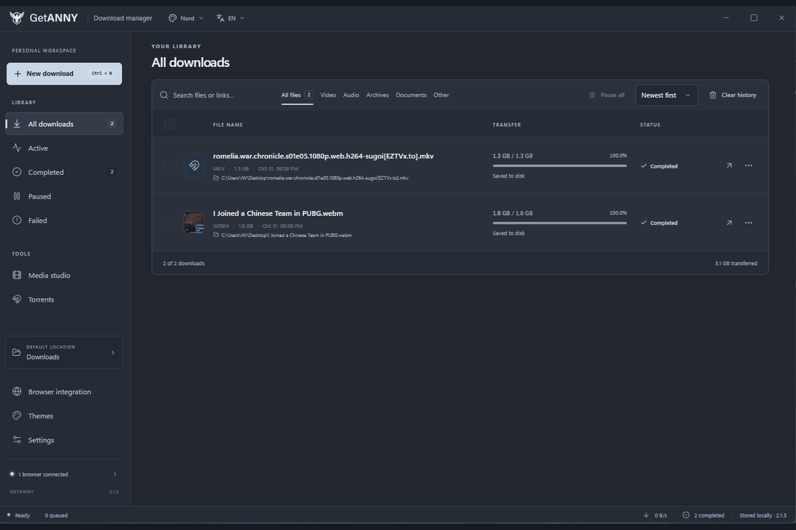

<p align="center">
  <picture>
    <source media="(prefers-color-scheme: dark)" srcset="assets/brand/lockup-horizontal-white.png">
    
  </picture>
</p>

<h1 align="center">GetANNY</h1>

<p align="center"><strong>A focused Windows download manager for files, media and browser downloads.</strong></p>

<p align="center">
  <a href="https://github.com/p4yy/GetANNY/releases/latest">Download for Windows</a>
  ·
  <a href="https://github.com/p4yy/GetANNY/releases">All releases</a>
  ·
  <a href="docs/INSTALL_WINDOWS.md">Installation guide</a>
  ·
  <a href="docs/BROWSERS.md">Browser setup</a>
</p>

GetANNY brings everyday downloads into one desktop workspace. Manage file transfers, inspect supported media, keep a searchable download history, and optionally connect your browser to GetANNY.

## See GetANNY in action

<p align="center">
  
</p>

<p align="center"><sub>The download library, media studio, browser setup and settings.</sub></p>

## Download GetANNY

<sub>Current release: **2.2.1** · Windows 10/11 · 64-bit</sub>

**[Open the official GetANNY 2.2.1 release page](https://github.com/p4yy/GetANNY/releases/tag/v2.2.1)**

Choose one Windows package:

| Package | Best for |
| --- | --- |
| [Setup (.exe)](https://github.com/p4yy/GetANNY/releases/download/v2.2.1/GetANNY-2.2.1-Setup.exe) | Recommended for most users |
| [Windows Installer (.msi)](https://github.com/p4yy/GetANNY/releases/download/v2.2.1/GetANNY-2.2.1-Setup.msi) | Managed or scripted Windows installation |
| [Portable (.exe)](https://github.com/p4yy/GetANNY/releases/download/v2.2.1/GetANNY-2.2.1-Portable.exe) | Running from a writable folder without a standard install |

Also available: [complete Windows bundle](https://github.com/p4yy/GetANNY/releases/download/v2.2.1/GetANNY-2.2.1-Windows-Bundle.zip) · [SHA-256 checksums](https://github.com/p4yy/GetANNY/releases/download/v2.2.1/SHA256SUMS.txt).

**Important:** Use only one installer format. The current release binaries are unsigned. Windows may show a SmartScreen warning; review the release notes and verify the downloaded file against the published SHA-256 checksums before running it.

## What's new in 2.2.1

Version 2.2.1 tightens the download library's empty states, keeps navigation steady during progress updates, adds a theme-matched activity pulse and remaining-time labels, fixes dragging `.torrent` files from Windows Explorer, and bundles the browser extensions inside the app. Browser integration now has an **Install extension** action that prepares the files and opens the selected browser's extension manager. After the browser's required approval, GetANNY verifies the connection automatically. The standalone extension ZIPs remain in the Windows bundle as a manual fallback.

## What's new in 2.2.0

### Capture downloads from anywhere

- Drop a direct HTTP or HTTPS link anywhere in the app to open **New download** with the link filled in.
- Drop a recognized media page to open **Media Studio**, or drop a magnet link or `.torrent` file/link to open the torrent flow.
- Use **Paste from clipboard** in an empty library view to route a copied link, magnet link or `.torrent` path.
- Optional clipboard monitoring is off by default. When enabled, GetANNY checks once per second and shows a five-second prompt when it finds a supported link; you choose whether to capture it.

### Queue playlists from Media Studio

- Load supported playlists and channels and review up to 1,000 entries in a virtualized list.
- Select, clear or invert the selection, choose an MP4 quality target, then queue the selected videos as individual library downloads.
- Items without a matching MP4 format are skipped and reported. Availability and formats depend on the source site; the single-video workflow remains available.

### Optional browser cookie handoff

- The browser extension's **Include site cookies** option is off by default. When enabled for a direct file handoff, it requests cookies matching that link's URL; it does not read or send the browser's entire cookie store.
- The desktop app keeps the received session headers in memory for that transfer and excludes them from saved download records and application logs. Redirects to another origin drop those headers. After an interrupted transfer, GetANNY asks you to refresh the handoff in your browser.
- This feature does not provide a guarantee of physically overwriting every temporary copy held by the JavaScript runtime. Browser and site support still apply.

### A smoother library and clearer transfer status

- Download lists switch to windowed rendering for larger libraries, and playlist results are virtualized. This keeps the interface from mounting every row at once.
- The footer refreshes transfer status once per second and shows download speed, active transfers and queued work. Torrent upload speed appears when available; clicking the status opens **Active** downloads.
- Major workspace panels have error boundaries so a panel error can be contained without taking down the whole app.

### Optional completion sound

- A soft bundled chime can play when a download completes. It is enabled by default, with a volume control and preview button in **Settings → Application**.
- Playback is throttled to one chime within two seconds, and audio errors are ignored so an unavailable sound device does not interrupt downloads.

The release retains the existing themes, languages and **Ctrl+N** shortcut. See the [release notes](docs/RELEASE_NOTES.md) for implementation details and the [release verification status](docs/RELEASE_STATUS.md) for build and test limitations.

## What GetANNY does

### Download manager
- Download files over HTTP and HTTPS, including large files.
- Show transfer progress, speed and estimated time when the server provides enough information.
- Pause, resume, retry and manage multiple downloads.
- Use verified range requests when the server supports them.
- Keep download history in a local SQLite database.
- Search, filter, sort, inspect, open and reveal completed downloads.
- Never overwrites existing files or runs downloaded files automatically.

### Media downloads
- Inspect supported media pages with yt-dlp.
- Choose available video or audio formats and resolutions.
- Download subtitles and thumbnails when the source provides them.
- Use bundled FFmpeg for supported audio extraction and format processing.
- Track queued jobs, progress, processing and completed output.

Website support depends on the source site, authentication, region and changes to that site's delivery system. GetANNY does not bypass DRM or guarantee that every website can be downloaded.

### Torrent downloads
- Add magnet links, local `.torrent` files or supported HTTP/HTTPS `.torrent` links.
- Track torrent progress in the same library as other downloads. Saved pieces are checked before a resumed transfer continues.

### Browser integration
GetANNY can work with:
- Google Chrome, Chromium, Microsoft Edge, Brave, Firefox, Vivaldi, Opera and Helium.

The matching browser extension can hand supported downloads to the desktop app and provides media actions where available. Setup is guided from inside GetANNY. **Extensions are not silently installed or enabled**; you must approve browser installation and permissions yourself.

### Preferences and workspace
- 12 curated themes, with a choice to follow the system's light or dark appearance.
- English, Arabic, French and Spanish interface languages; Arabic uses a right-to-left layout.
- Download folder, simultaneous-download limit, per-file connections, speed limits and a daily start schedule.
- Startup and tray behavior, completion notifications and optional completion sound.
- Reduced-motion and compact-list preferences, plus **Ctrl+N** to start a new download.

## Getting started

1. Download one of the Windows packages from the [official release page](https://github.com/p4yy/GetANNY/releases/tag/v2.2.1).
2. Install GetANNY, or run the portable build from a writable folder.
3. Open GetANNY and choose your download folder and preferences.
4. To use browser integration, open the in-app browser setup guide and follow the instructions for your browser.
5. Add a direct file URL or use a supported browser action to send a download to GetANNY.

See the [Windows installation guide](docs/INSTALL_WINDOWS.md) and [browser setup and troubleshooting guide](docs/BROWSERS.md) for details.

## Privacy and security

- Download history and preferences are stored locally in the app's user-data folder.
- Browser integration uses a local authenticated bridge; it is not intended to expose a remote service.
- Browser permissions and extension installation are presented for user approval.
- Downloaded files are not automatically executed.
- GetANNY does not claim to bypass DRM or browser/site access restrictions.

For security details, see [Architecture and security contracts](docs/ARCHITECTURE.md). To report a vulnerability, follow [SECURITY.md](SECURITY.md).

## For developers

GetANNY is a Windows-first Electron application built with React, Vite and SQLite.

**Requirements**
- Node.js 22.22 or newer
- npm
- Windows build tools for native modules and Windows packaging

**Run locally**

```sh
npm ci
npm run prepare:tools
npm run build-extension
npm run dev
```

**Run tests and build**

```sh
npm test
npm audit --audit-level=high
npm run build:renderer
npm run build:win
```

See the project documentation for [architecture](docs/ARCHITECTURE.md), [testing](docs/TESTING.md), [Windows packaging](docs/INSTALL_WINDOWS.md), [browser integration](docs/BROWSERS.md), and [release notes](docs/RELEASE_NOTES.md).

## License

GetANNY is released under the [Apache License 2.0](LICENSE). Third-party tools and bundled components retain their respective licenses; see [third-party notices](docs/THIRD_PARTY.md).
