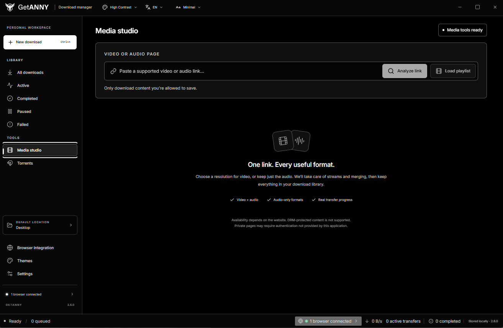
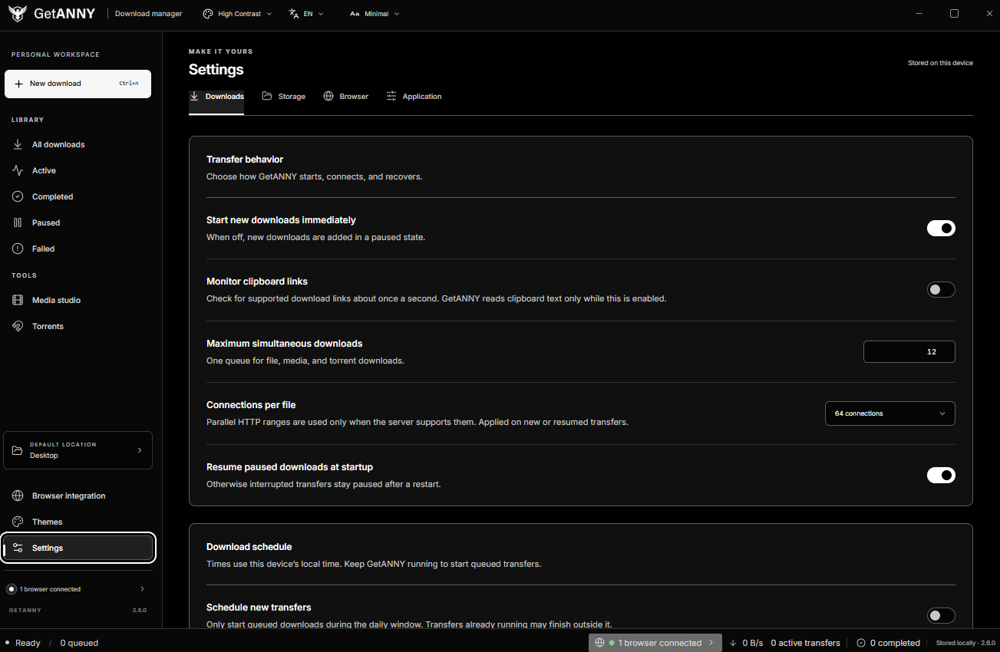
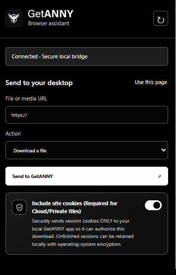
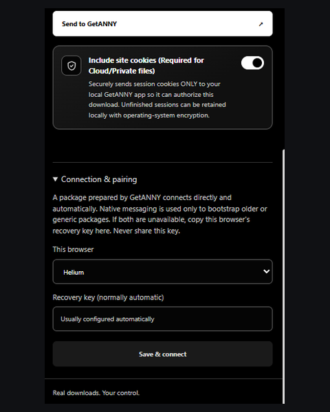

<p align="center">
  <picture>
    <source media="(prefers-color-scheme: dark)" srcset="assets/brand/lockup-horizontal-white.png">
    
  </picture>
</p>

<h1 align="center">GetANNY Download Manager</h1>

<p align="center"><strong>A Windows desktop app for file downloads, supported media and browser handoff.</strong></p>

<p align="center">
  <a href="https://github.com/p4yy/GetANNY/releases/latest">Download for Windows</a>
  &nbsp;·&nbsp;
  <a href="docs/INSTALL_WINDOWS.md">Installation</a>
  &nbsp;·&nbsp;
  <a href="docs/ARCHITECTURE.md">Architecture</a>
  &nbsp;·&nbsp;
  <a href="docs/NATIVE_MESSAGING.md">Browser integration</a>
</p>

<p align="center">
  <a href="https://github.com/p4yy/GetANNY/actions/workflows/release.yml"></a>
  <a href="https://github.com/p4yy/GetANNY/releases/latest"></a>
</p>

<p align="center">
  
</p>

GetANNY brings supported downloads into one desktop workspace. It combines a resumable HTTP transfer manager, media extraction and conversion tools, WebTorrent transfers, and an optional browser extension.

## Download

Get the current Windows Setup EXE from the [GitHub Releases page](https://github.com/p4yy/GetANNY/releases/latest). Verify its SHA-256 against the checksum published with that exact release before running it. Read the [Windows installation guide](docs/INSTALL_WINDOWS.md) for setup, upgrade and verification details.

The installer is unsigned unless the release's Authenticode evidence says otherwise. Windows may show a SmartScreen warning for an unsigned build.

## Features

- **File downloads:** HTTP and HTTPS transfers with progress, pause, resume, retry, per-download limits and searchable local history.
- **Media Studio:** inspect supported media pages, select available formats, download provided subtitles or thumbnails, and choose a video time range.
- **Torrents:** add magnet links, local `.torrent` files or supported `.torrent` URLs. WebTorrent is the active transfer engine; results depend on reachable peers and seeders.
- **Browser handoff:** send supported downloads from Chromium-family browsers and Firefox through an authenticated local connection. Extension installation and permissions always require your approval.
- **Workspace controls:** themes, interface languages, scheduling, speed limits, notifications and tray behavior.

GetANNY does not bypass DRM, site access restrictions or authentication requirements. Media availability depends on the source and the tools it permits.

## Screenshots

<details>
<summary>View desktop and browser screenshots</summary>

### Desktop app

<table>
  <tr>
    <td align="center" width="50%"><a href="docs/media/screenshots/downloads.png"></a><br><sub><strong>Downloads</strong><br>Transfer list and status</sub></td>
    <td align="center" width="50%"><a href="docs/media/screenshots/themes.png"></a><br><sub><strong>Themes</strong><br>Application appearance</sub></td>
  </tr>
  <tr>
    <td align="center" width="50%"><a href="docs/media/screenshots/media-studio.png"></a><br><sub><strong>Media Studio</strong><br>Supported media formats</sub></td>
    <td align="center" width="50%"><a href="docs/media/screenshots/settings.png"></a><br><sub><strong>Settings</strong><br>Transfer and workspace preferences</sub></td>
  </tr>
</table>

### Browser integration

<table>
  <tr>
    <td align="center" width="50%"><a href="docs/media/screenshots/browser-extension-details.png"></a><br><sub><strong>Extension details</strong><br>Permissions and browser settings</sub></td>
    <td align="center" width="50%"><a href="docs/media/screenshots/browser-extension-popup.png"></a><br><sub><strong>Browser assistant</strong><br>Supported downloads and media links</sub></td>
  </tr>
  <tr>
    <td align="center" width="50%"><a href="docs/media/screenshots/browser-connection-pairing.png"></a><br><sub><strong>Connection</strong><br>Browser setup and pairing</sub></td>
    <td align="center" width="50%"><a href="docs/media/screenshots/browser-extension-toolbar.png"></a><br><sub><strong>Toolbar</strong><br>Browser extension action</sub></td>
  </tr>
</table>

</details>

## Videos

- [Windows installation and browser setup](https://youtu.be/lzJW8I6n3Yw) · [Download MP4](docs/media/demonstration/installation.mp4)
- [GetANNY product walkthrough](https://youtu.be/jrJ0kYSQAlk) · [Download MP4](docs/media/demonstration/getanny-in-action.mp4)

## Getting started

1. Download and verify the Windows Setup EXE.
2. Run the installer and open GetANNY.
3. Choose your download folder and review the transfer preferences.
4. For browser handoff, open **Browser integration** and follow the [browser setup guide](docs/NATIVE_MESSAGING.md).
5. Add a direct file URL, use a supported browser action, or analyze a supported media page.

## Privacy and security

Download history and preferences are stored locally. The browser bridge listens only on loopback and requires a browser-scoped credential. The extension does not read website passwords, and it does not install itself or change browser policies. Matching site cookies are used for download handoff according to the per-site popup setting; see [PRIVACY.md](PRIVACY.md). Report vulnerabilities through the private process in [SECURITY.md](SECURITY.md).

## Developers

GetANNY is a Windows-first Electron application using React, Vite, SQLite, WebTorrent and a compiled Windows setup/bridge layer.

**Requirements:** Node.js 22.22+, npm, Windows C++ build tools and SDK, Python for native dependency builds, and the .NET 10 SDK for the WPF setup shell.

```powershell
npm ci --ignore-scripts
npm run prepare:tools
npm run build-extension
npm test
npm audit --audit-level=high
npm run audit:locales -- --strict
npm run build:renderer
npm run build:setup-ui
```

The final branded Setup EXE is built and verified by the Windows Actions workflow. A raw NSIS build is not the same as the branded installer. See [Architecture](docs/ARCHITECTURE.md) for the service boundaries and [Windows installation/build guide](docs/INSTALL_WINDOWS.md) for the candidate build and release gates.

## Support

If you find GetANNY useful, you can support development through [PayPal](https://www.paypal.com/paypalme/aceevisuals) or [Ko-fi](https://ko-fi.com/acevisualsco).

## License

GetANNY's project code is licensed under the [Apache License 2.0](LICENSE). Third-party tool, font and dependency notices are in [NOTICE](NOTICE).

<p align="center">
  <picture>
    <source media="(prefers-color-scheme: dark)" srcset="assets/brand/acev-apps-co-wordmark-white.png">
    
  </picture>
</p>
